# Learning Tracker

> Kunlik o'rganish jurnali — har kuni nima o'rgandingiz, qancha vaqt sarfladingiz va qanday his qildingizni qayd eting.

**Stack:** Kotlin · Jetpack Compose · Material 3 · Room · DataStore · Navigation Compose

---

## Ekranlar

### 1. Bugungi Yozuv — Yangi Sessiya

Har kuni o'rganish ma'lumotlarini kiritish uchun asosiy ekran. Sana, ishlagan soat, yopilgan vazifalar soni, asosiy mavzu va uchta baholash (Tushunish, Energiya, Fokus) ni 1–5 dan belgilaysiz. Pastga g'alaba va qiyinchiliklarni yozasiz.

| Yorug' rejim | Qorong'i rejim |
|:---:|:---:|
| 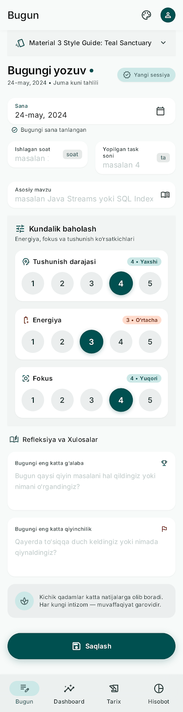 | 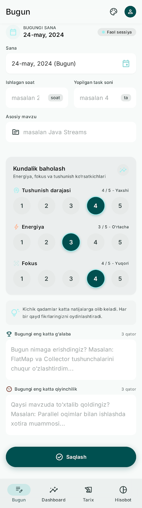 |

**Elementlar:**
- Sana tanlagich (Calendar)
- Ishlagan soat va yopilgan vazifalar (2 ustunli)
- Asosiy mavzu matni
- Baholash kartasi: Tushunish / Energiya / Fokus (1–5 dumaloq tugmalar)
- G'alaba va qiyinchilik matn maydonlari
- Pastga yopishib turadigan **Saqlash** tugmasi

---

### 2. Yozuvni Tahrirlash (Edit Mode)

Avvalgi yozuvni tahrirlash rejimi. "TAHRIRLASH REJIMI" chipi bilan yangi sessiyadan farq qiladi. Oxirgi saqlash vaqti ko'rsatiladi. Tugmalar: **O'zgarishlarni saqlash** va **O'zgarishlarni bekor qilish**.

| Tahrirlash rejimi |
|:---:|
| 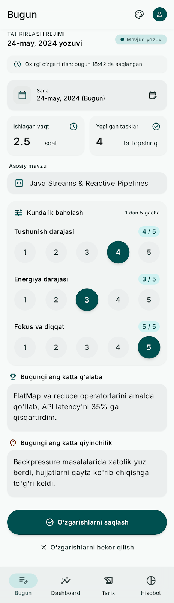 |

---

### 3. Dashboard

Umumiy tahlil va rivojlanish dinamikasi. Joriy streak, bugungi yozuv holati, o'rtacha ko'rsatkichlar (7 kun / 30 kun toggle), sarflangan vaqt va energiya/fokus chiziqli grafigi.

| Yorug' rejim | Qorong'i rejim | Yozuv kiritilmagan |
|:---:|:---:|:---:|
| 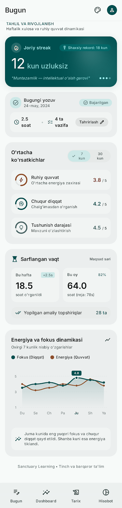 | 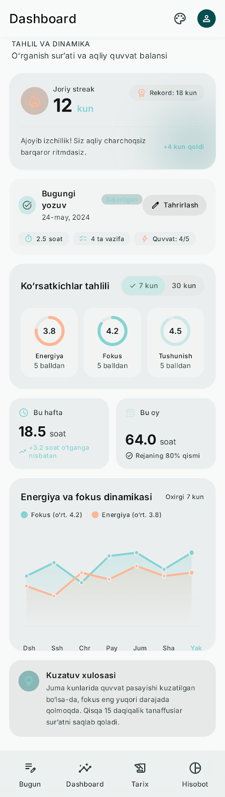 | 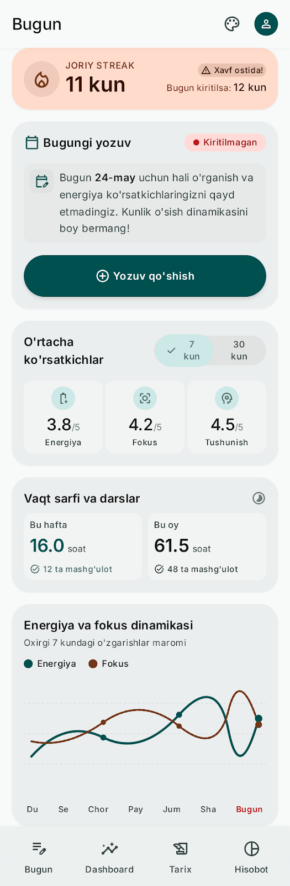 |

**Elementlar:**
- **Streak hero kartasi** — joriy uzluksiz kunlar soni (katta raqam)
- **Bugungi yozuv holati** — "Bajarilgan" chipi (soat + vazifa) yoki "Kiritilmagan" + "Yozuv qo'shish" tugmasi
- **O'rtacha ko'rsatkichlar** — Energiya, Fokus, Tushunish halqa diagrammalari (7 kun / 30 kun)
- **Sarflangan vaqt** — Bu hafta / Bu oy, 2 ustunli kartalar
- **Energiya va fokus dinamikasi** — oxirgi 7 kunlik chiziqli grafik

---

### 4. Tarix

Barcha yozuvlar ro'yxati, eng yangi birinchi. Sana oralig'i va quvvat bo'yicha filter chiplaari. Har bir karta: sana, mavzu, soat/vazifa chipalari, uchta kichik reyting ko'rsatkichi.

| Tarix ro'yxati | O'chirish dialogi | Bo'sh holat |
|:---:|:---:|:---:|
| 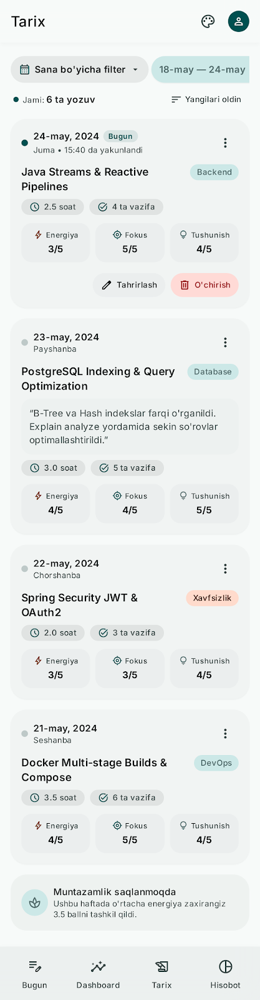 | 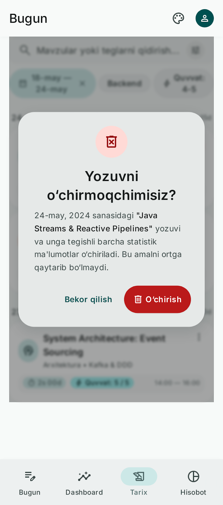 | 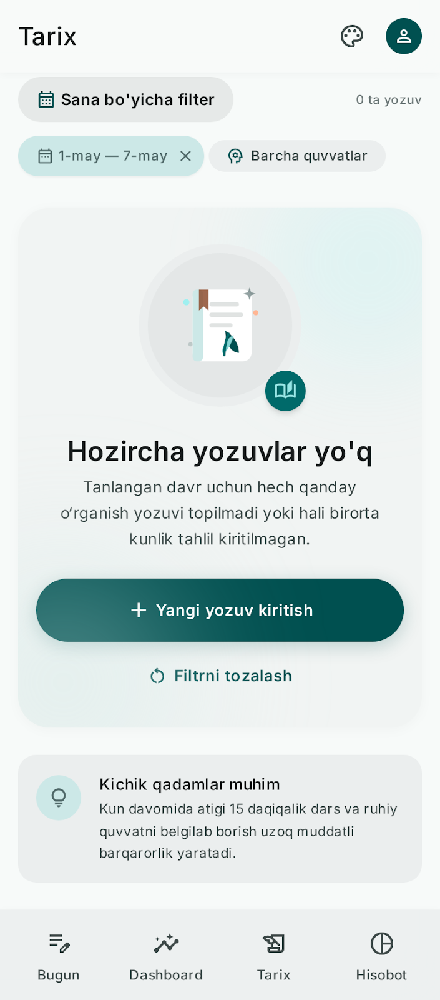 |

**Elementlar:**
- Sana filter chipi (tanlanganda × belgisi bilan)
- Yozuv kartasi: sana + mavzu (titleMedium), soat/vazifa chipalari, Energiya/Fokus/Tushunish reytinglari
- **Tahrirlash** va **O'chirish** tugmalari har bir kartada
- O'chirish dialogi: "Yozuvni o'chirmoqchimisiz?" + tasdiqlash/bekor qilish
- Bo'sh holat: "Hozircha yozuvlar yo'q" + "Yangi yozuv kiritish" tugmasi

---

### 5. Haftalik Hisobot

Tanlangan hafta uchun to'liq statistika. Hafta aylantiruvchi (`<` tanlangan davr `>`), jami soat va vazifalar, o'rtacha ko'rsatkichlar, kunlik soat bar grafigi, top g'alabalar va qiyinchiliklar ro'yxati.

| Yorug' rejim | Qorong'i rejim | Bo'sh holat |
|:---:|:---:|:---:|
| 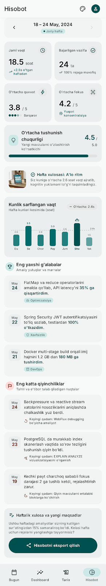 | 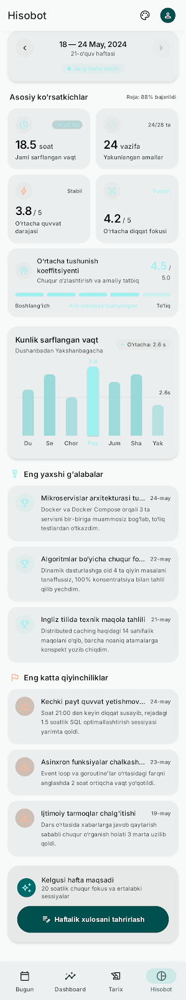 | 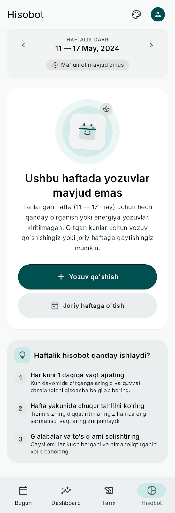 |

**Elementlar:**
- Hafta navigatori (`<` / `>` tugmalar + sana oralig'i)
- 2×2 ko'rsatkichlar panjarasi: Jami vaqt, Bajarilgan vazifalar, O'rtacha quvvat, O'rtacha fokus
- Kunlik soat bar grafigi (Dush–Yak)
- **Eng yaxshi g'alabalar** — haftaning top 3 ta yutug'i
- **Eng katta qiyinchiliklar** — haftaning top 3 ta muammosi
- **Haftalik xulosani tahrirlash** tugmasi
- Bo'sh holat: "Ushbu haftada yozuvlar mavjud emas" + "Yozuv qo'shish" / "Joriy haftaga o'tish" tugmalari

---

## Navigatsiya

Pastki navigatsiya paneli 4 ta bo'limdan iborat:

| Ikon | Bo'lim | Tavsif |
|:---:|---|---|
| ✏️ | **Bugun** | Bugungi yozuv kiritish / tahrirlash |
| 📊 | **Dashboard** | Umumiy tahlil va grafik |
| 📋 | **Tarix** | Barcha yozuvlar ro'yxati |
| 📅 | **Hisobot** | Haftalik statistika |

---

## Mavzu (Rang Sxemasi)

**"Teal Sanctuary"** — tinchlantiruvchi ko'k-yashil (teal) asosiy rang, engil soyasiz tonal sirtlar.

| | Yorug' | Qorong'i |
|---|---|---|
| Primary | `#005050` | `#4DDAD8` |
| Background | `#F7FAF9` | `#191C1B` |
| Secondary Container | `#CCE8E7` | `#324B4B` |

Fokus grafigi: `primary` rang · Energiya grafigi: `tertiary` rang

---

## Arxitektura

```
data/   — Room (entity, DAO, database), mapper, RepositoryImpl, DataStore
domain/ — model, Repository interfeys, use-case-lar (Android importlarsiz)
ui/     — theme, navigation, components, screen + ViewModel + UiState
```

- **DI**: qo'lda `AppContainer` (`Application` klasida) — Hilt/Koin yo'q
- **ViewModel**: har biri bitta `StateFlow<UiState>` chiqaradi
- **Saqlash**: Room (barcha yozuvlar) + DataStore (mavzu tanlovi)
- **minSdk** 26 · **Package** `uz.learningtracker`

---

## Build

```bash
./gradlew assembleDebug          # APK yig'ish
./gradlew testDebugUnitTest      # unit testlar
./gradlew lintDebug              # lint tekshiruvi
```
